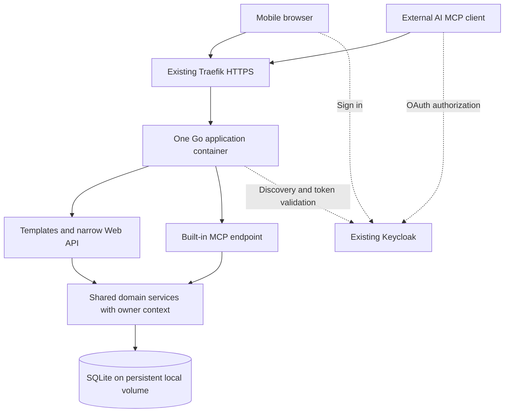

# Architecture and infrastructure

Selected October 19, 2026. This is a design, not a deployed shopping service.

## Runtime layout

No separate MCP gateway, frontend server, Redis, message broker, or in-app AI runtime is required. SSHMCP is a separate administration capability; shopping tools execute directly inside the shopping service.

## Application organization

Suggested packages, refine without overengineering:
- cmd/shopping: composition, startup, shutdown and routing.
- internal/identity: Keycloak integration, web sessions, token verification and owner context.
- internal/shopping: product/list/purchase/preferences services and validation.
- internal/store/sqlite: owner-scoped persistence, transactions, migrations and idempotency.
- internal/web: page renderers and browser handlers.
- internal/mcp: typed MCP tool adapters.
- internal/insights: fixed metric definitions using confirmed records.
- web/templates and web/static: Go templates and compiled assets.

Expose pages at /, browser JSON at /api/v1, remote MCP at /mcp, and web auth routes under /auth. The approved browser-only sharing slice adds public /s/{code} reads and revisioned capability/Origin-protected guest checkoff over separate snapshots; owner creation stays in the authenticated browser API. Its lifetime, disclosure and fixed global abuse budget are defined in docs/SHARING.md. Serve protected-resource metadata at the standard discovery location. User selected https://shopping.vvivid.dev and exact /api/v1 and /mcp audiences; registration, routing and live acceptance remain pending.

Use the official Go MCP SDK. Prefer stateless Streamable HTTP for this request/response tool workload, subject to client compatibility. Authenticate every request; bind any retained sessions to the same user/client. MCP does not require tool calls to loop through HTTP API routes: both adapters call shared services.

## Template UI

Use html/template and Tailwind styling matching the accepted prototype. The prototype's React/Radix components cannot be copied directly into Go templates. Preserve the shadcn-inspired appearance while implementing accessible HTML controls, focus handling and keyboard interaction.

Use a thin JS layer for checkoff, add-to-list, detail dialogs, search and revalidation. Refresh when returning to the visible page; bounded polling while visible is sufficient initially. Render the simple metric charts as server-derived SVG with text labels. Do not create a parallel client-side business model.

## SQLite and multi-user isolation

Start with one SQLite database and one application instance on the same host. Put the database in a persistent directory such as /data, outside the image. Keep images as remote sourced URLs initially. Any future owned assets must persist on the server under the same no-backup policy as the database.

Enable foreign_keys on all connections. Use WAL, bounded busy timeout/retries, a controlled writer and short transactions. Do not perform retailer requests while holding transactions. Define migrations and test both clean creation and upgrading existing data.

Owner columns, owner-qualified repository methods, and composite foreign keys protect related records. SQLite has no built-in PostgreSQL-style row-level security. Service checks and isolation tests are mandatory. Use revisions and transactional idempotency records for simultaneous browser/agent edits.

Do not place a shared writable SQLite file on a network filesystem or mount it into horizontally scaled app replicas. Reconsider PostgreSQL for measured sustained write contention, multiple app instances, or stronger availability requirements.

## Identity and browser sessions

Reuse the existing Keycloak instance and initially its existing issuer; provision separate shopping registrations. See docs/KEYCLOAK.md for observed state and the SSH-specific OAuth proxy constraint.

Web login uses authorization code + PKCE, with an encrypted or otherwise securely protected persistent server-side session store and secure HttpOnly cookies, SameSite policy and CSRF protection. Keep encryption keys outside the image and database, in runtime secrets, stable across restarts.

MCP bearer access tokens must have the correct issuer, signature, audience, time validity and scopes. The authenticated subject selects the data owner. No caller-supplied user ID or client ID can override identity. Shopping grants must not include SSH privileges.

## Deployment and operations

- Build one immutable application image, embedding templates/static assets or packaging them in the image. Tailwind compilation is build-time only.
- Traefik terminates TLS and routes the chosen app origin over an internal Docker network. Do not expose database access or unprotected app ports publicly.
- Preserve required MCP headers, origin validation and streaming behavior; test proxy timeouts with actual chosen clients.
- Run the container as a non-root user with only the writable data directory and necessary secrets.
- Readiness checks cover database availability and completed migrations; liveness should not depend on temporary Keycloak outages. Fail new authentication safely if discovery/keys cannot be validated.
- Structured logs include request IDs and safe actor identifiers, never credentials. Use existing observability infrastructure where useful.
- Use graceful shutdown and a restart policy. No process-local state may be the only copy of lists, sessions, idempotency results or pending confirmations.

## Restart and migration acceptance

Application restart must preserve checked state, lists, purchase history, preferences, owner boundaries and idempotency results. Uncommitted writes roll back; retrying an interrupted request cannot duplicate a purchase.

The user's October 19 policy keeps shopping data and runtime secrets only on the server. Do not create backups, snapshots, off-server copies, backup schedules or Mac recovery keys. No startup, enrollment, request handler or migration path invokes the existing manual backup tools. Historical synthetic recovery tests do not authorize production backup work.

Initialize only an empty schema or validate an existing application's consecutive migration names/checksums before upgrading it. Reject an existing schema with no application migration history. Apply each pending migration in a short transaction; a failure rolls back that migration, while earlier successful migrations remain applied. Startup and enrollment create no recovery archives or backup scratch directories. There are no down migrations or guaranteed recovery point: an older binary must reject a newer schema, and an incompatible release needs a compatible forward correction while preserving the existing server volume. Pin dependencies including the SQLite library and check current advisories before release.

External agents or schedulers initiate maintenance. The Go service exposes MCP tools; it does not start autonomous AI runs.
