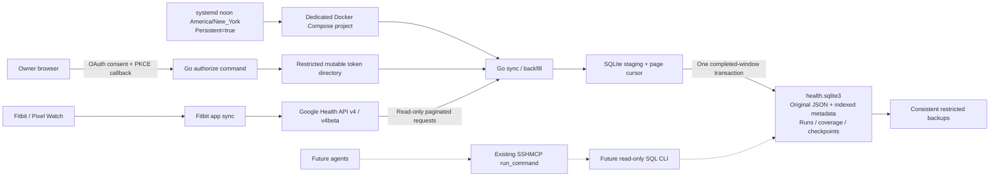

# Google Health importer architecture

Checkpoint 0 is approved. V1 is a personal Go importer and SQLite datastore. It does not expose an MCP server. Only activity, sleep, and health-metric read scopes are requested; GPS, nutrition, ECG, IRN, and write scopes are excluded.

## Current boundary

The local executable provides `authorize`, `backfill`, `sync`, and `status`. Its JSON output contains operational state, counts, dates, stable error codes, and optional numeric HTTP/SQLite failure codes. Health values, identities, tokens, OAuth codes, SQL text, and provider error bodies are never printed. The sole browser URL emitted during interactive authorization is ephemeral and is not a credential file.

The source of truth remains Google. Reconciled reads use Google's `dataPoints:reconcile` endpoint rather than adding overlapping raw intervals. Original returned records are stored as JSON. A window is visible in the main table only after its final page is committed together with its coverage checkpoint. Failed windows preserve the previous completed view. Staged pages and cursors resume unless another overlapping window of the same stream has published in the meantime. Each publication atomically invalidates staging and cursors for those older pending snapshots; their next attempt refetches the original bounds. This preserves newer corrections, late uploads, and source deletions. Failed publication rolls back both replacement and invalidation. Complete windows and unrelated pending cursors retain their state.

Daily windows occupy a separate storage namespace from historical/manual windows. They retain the earliest date still partial when their transfer began, together with their exact bounds and cursor. `sync` resumes unfinished daily transfers before planning current requests. The final-page transaction also advances the daily frontier, capped at that original partial date, so downtime cannot skip its later uploads. Timestamp streams use UTC; civil exercise/daily/rollup streams keep UTC−12's current date open and query through UTC+14's current date. This conservatively covers unknown locations and travel without another OAuth scope. Civil refreshes cover eight or nine dates, split into requests of at most seven dates. Historical failure evidence remains visible; daily readiness uses the same metric clock policy and the selected default history plans.

Schema version 4 preserves version-1 records and remaps staged daily transfers and token references in one migration transaction after a consistent restricted backup. The version-2 correction rewinds civil frontiers and saved partial dates by one date. The version-3 correction resets only pending transfers that overlap another recorded publication, even if its next refresh is unfinished. Older schemas lack reliable snapshot ordering, so those ambiguous transfers refetch from page one. Nonoverlapping cursors and staging remain resumable. Published records, frontiers, pending bounds/IDs, partial dates, and failure evidence are unchanged by the publication correction. Existing history ends remain pinned; new plans pin separate UTC and civil ends, including timezone-ahead current civil dates. A failed migration retains the original schema, transfer state, and backup.

The owner selected all supported Google Health data from **2026-06-14 inclusive**, without a Fitbit-only source filter. `backfill --history-since 2026-06-14` saves `history_since`, the matching explicit aggregate floor, and both clock-specific ends in one metadata transaction before any import page. Validation rejects malformed dates, a floor at/after either end, and conflicting source/aggregate choices without changing metadata. No schema migration is needed. The source windows retain their existing end-based 30-day alignment and in-range cursor IDs; only the floor-crossing window changes. Aggregates use the same floor in requests of at most 14 days. Empty windows never terminate in-range collection.

Flag-free backfill and scheduled continuation use that saved scope. Daily source and aggregate requests also stop at the floor: wholly in-range pending transfers retain their cursor, crossing transfers start a clipped snapshot, and older attempts remain as audit rows. Existing older canonical records and original JSON are retained. Status reports `history_scope: "selected_range"`, its inclusive start and UTC/civil exclusive ends; history completion and readiness refer to that selected range. Out-of-range failures stay visible without blocking it, and unfinished in-range work remains required. Offline planning/status never writes history settings.

An explicit `--since`/`--until` repair does not change the saved scope. A datastore without `history_since` retains the legacy unbounded older source tail and an aggregate floor inferred from source records until `--aggregate-since` supplies an explicit date. The three approved scopes do not permit `GetProfile`, so no profile permission is requested to guess an account date. The owner's June 14 choice supersedes the earlier requirement to finish lifetime source discovery.

## Durable deployment

- Compose project and source: `/home/admin/infrastructure/google-health`.
- Datastore: `/home/admin/data/google-health/health.sqlite3` on a persistent directory bind mount.
- OAuth client file: restricted read-only secret mount.
- Token store: restricted **directory** bind mount, writable for atomic refresh-token replacement.
- SQLite scratch: `/data/scratch` within the persistent database bind mount, mode `0700`, selected through `SQLITE_TMPDIR`. Compose's entrypoint verifies it is private and writable before Go opens any database; the 16 MiB memory-backed `/tmp` remains unchanged.
- One-shot service and daily timer: noon in `America/New_York`, independently of the host timezone, with a persistent missed-run catchup.
- A database-adjacent OS lock serializes authorization, migrations, backfills, and scheduled writes. SQLite WAL permits external read-only readers.

Root coordinates remote installation after the sequential implementation, readability, and independent review stages. The collector does not require changes to other infrastructure services.

The owner explicitly chose plaintext storage; no encrypted volume was provisioned. File modes restrict access but do not provide at-rest encryption. See the README's Google policy limitation. The history selection preserves schema 4, original JSON, atomic publication/overlap invalidation, and wholly in-range saved cursors.

## Public information boundary

The owner separately authorized an informational website at `health.vvivid.dev` for the **Personal Health Collector** OAuth app. `site/` contains static overview, privacy, and use/contact pages. It does not host authorization callbacks, health queries, account access, or a dashboard.

`deploy/site.compose.yaml` defines the separate `google-health-info` project. Its pinned unprivileged NGINX container mounts only `site/` and its static server config read-only, uses a read-only root filesystem with temporary NGINX files in `/tmp`, drops capabilities, and has no published host port. Relative directory redirects preserve the browser's HTTPS origin behind the existing Traefik TLS router. There is no mount or application connection from this service to the collector, OAuth credentials, or SQLite database. Cloudflare and hosting services may process or log ordinary public request metadata.

The pages describe the private archive and a future owner-authorized agent query interface. They do not implement that interface. Source readiness, website publication, OAuth Branding completion, Google publishing status, and unattended collector readiness are separate evidence gates.

## Checkpoint 5: future query access

Future agents will use the existing SSHMCP `run_command` to invoke a read-only SQL CLI on this datastore. It must expose **all tables, all columns, and all original JSON**. It must accept arbitrary read-only `SELECT` statements, joins, CTEs, window functions, and SQLite JSON functions. It must not impose a metric allowlist, fixed queries, or a date cutoff.

That CLI must enforce SQLite read-only access and reject writes, attachment of writable databases, unsafe extension loading, and mutation through SQL functions. This is an execution safety boundary, not a data restriction. Design and implementation of that interface are outside V1; no dedicated health MCP server is planned.
