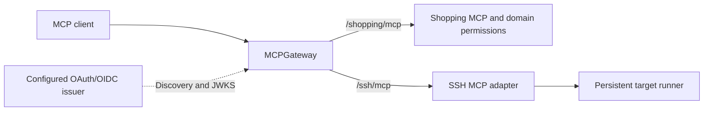

# MCPGateway

A self-hosted MCP gateway with separate configured endpoints for independent MCP
services. The gateway authenticates callers, checks route access and forwards a
short-lived verifiable identity. Services own their tools, data and authorization.
Keycloak is an initial OAuth/OIDC provider, not a core dependency.

Status: V1 implementation under development; live provider/client acceptance is
pending. See [rollout acceptance](docs/ROLLOUT.md). No production deployment is
implied by this source change.



## Build and run

Go 1.26.9 or newer:

```sh
make check build
# Use an operator-owned private configuration directory; never commit its keys.
bin/gateway-keygen --private /private/gateway.private.json --public /private/public.jwks.json
bin/mcp-gateway --config /private/gateway.json
```

The key generator refuses to overwrite files. If its second output fails, retain
and inspect the first output before retrying; it does not roll back key creation.
Gateway startup never generates or rotates credentials. Give the runtime user
read access to its private JWK (0400/0600), and distribute only the public JWKS to
backends. Keep configuration and credentials outside images and source control.

Adapt [gateway.json](examples/gateway.json). Required top-level fields are
`listen`, public `origin`, OAuth/OIDC `issuer`, `signing_key_file` and `routes`.
Each route requires a distinct name, canonical path ending `/mcp`, fixed upstream,
distinct backend audience, required scopes, forwarded scopes, allowed OAuth
client IDs and a positive `max_token_lifetime_seconds`. Missing, zero, negative
or non-integer lifetime limits fail startup. `upstream_host` optionally preserves
a backend's configured canonical Host, notably Shopping. Public URLs require
HTTPS; HTTP loopback is accepted for
local development. Internal upstream HTTP requires a trusted private network.
The gateway does not forward client cookies, identity headers, bearer tokens or
HTTP trailers. Backend response trailers are also discarded.

`GET /health/live` indicates a running HTTP handler. `/health/ready` indicates
successful startup configuration, key loading and issuer discovery; neither
asserts backend availability or ongoing issuer connectivity. Requests must use
the configured canonical Host, including health probes. Metadata is public at
`/.well-known/oauth-protected-resource/<service>/mcp` for each route.

HTTPS terminates at the operator's existing reverse proxy. Preserve canonical
Host and streaming, restrict the internal listener, and do not expose backends.
[Container deployment skeleton](examples/compose.yaml) needs environment-specific
networking and HTTPS routing before use. The loopback SSH backend and gateway
must share a host/network namespace or use an explicit private tunnel. Image
builds use this directory as context: `docker build -t mcp-gateway .`.

## Authentication and permissions

The built-in authenticator supports signed RS256 JWT access tokens from one
configured discovered issuer. It accepts RFC 9068 `at+jwt` tokens with `client_id`,
or `JWT` tokens explicitly marked with payload `typ=Bearer` and `azp` (Keycloak).
Opaque tokens, arbitrary JWT profiles and ID tokens are unsupported. Verification
requires exact issuer, exactly one route-resource audience, valid expiry/issued-at
and not-before, subject and client identity. Conflicting client claims fail.

The core applies each route's `max_token_lifetime_seconds` to verified token
timing, regardless of provider: issuance must be positive and not in the future,
expiry must be in the future, and both the issued lifetime and remaining lifetime
must fit the limit. The examples set 300 seconds for Shopping and SSH. Shopping
requires at most 300 seconds to preserve its provider revocation bound; do not
increase that route's limit. Choose an explicit revocation bound for each new
backend and configure its provider to issue compatible access tokens. An old,
long-lived token is rejected even when fewer than 300 seconds remain. The gateway
rechecks timing after reading the request body, before issuing backend identity.
Internal tokens expire within 60 seconds and never after the external expiry;
minting another internal token cannot extend the external grant. Clients obtain
fresh external access tokens through their provider's authorized refresh flow.

Each resource is the exact public origin plus route path. Configure provider
clients, callbacks, PKCE, consent, resource/audience bindings and permissions for
those resources. Discovery tells clients which issuer to use; the gateway is not
an authorization server, token issuer for clients, client-registration service or
OAuth login proxy. A provider's unsupported resource behavior needs an explicit
provider integration, not weakened audience checks. Existing SSH Keycloak
compatibility guards remain in the legacy lab path.

Route access requires both an allowed OAuth client and all configured required
scopes. Only the intersection of granted scopes and the route's `forward_scopes`
is sent to its backend: configuration never invents a permission. Each backend
still enforces domain scopes and ownership. Avoid combining SSH and Shopping
audiences or permissions in a client grant.

`gateway.Authenticator` is the extension boundary for a future authentication
method. Routing accepts a normalized principal; it contains no provider roles,
Keycloak realms or hardcoded services. Multiple simultaneous issuers, account
linking and provider administration are outside V1.

## Backend identity and integration

See [the v1 identity contract](docs/IDENTITY.md). External access tokens are never
passed to the backend. Backends verify a separate gateway-signed token for their
own audience, preserving original `(issuer, subject)` and OAuth client identity.

**Shopping:** retain its complete existing identity configuration. Add:

```text
SHOPPING_GATEWAY_ISSUER=https://mcp.example.com
SHOPPING_GATEWAY_AUDIENCE=shopping-mcp
SHOPPING_GATEWAY_JWKS_FILE=/etc/mcp-gateway/public.jwks.json
```

When configured, `/mcp` accepts only gateway identity tokens. Browser login,
sessions and `/api/v1` retain existing authentication. Shopping still requires an
active enrolled original issuer+subject, allowed shopping client and shopping
permissions. Switching identity issuers requires explicit account enrollment or
migration; matching emails does not link accounts. Without gateway settings,
existing direct MCP authentication remains available for staged migration.

**SSH:** build/run `SSHMCP/cmd/sshmcp-server` with
[backend configuration](examples/ssh-backend.json), not the legacy
`sshmcp-gateway` executable. It exposes the existing three tools over loopback
HTTP with gateway-only authentication. It does no OIDC discovery and starts no
Keycloak proxy. SSH host pinning, restricted runner RPC, persistent shells,
durable jobs, idempotency and cancellation stay in SSHMCP. The existing legacy
lab executable remains available until the rollout is verified.

**Reference backend:** `bin/example-mcp --listen 127.0.0.1:8099 --gateway-issuer https://mcp.example.com --audience example-mcp --jwks /private/public.jwks.json` exposes `whoami` with `example:read`. Add an `/example/mcp` route to its internal `/mcp` endpoint and configure that permission and allowed client. This is a synthetic demonstration, not a domain service.

**New service:** deploy a stateless Streamable HTTP MCP server, implement the
identity contract, add a route and provider resource/client permissions, then
verify discovery, calls, denied access and user isolation. Add its endpoint to
clients separately. No shared tool catalog or tool renaming is performed.

## Protocol and failure boundaries

V1 targets the existing Go MCP SDK v1.8.0 stateless Streamable HTTP backends and
protocol versions they support. It forwards POST, GET and DELETE to exact fixed
paths, preserving Accept, Content-Type and MCP protocol-version headers.
Requests also preserve `Mcp-Method`, `Mcp-Name` and the protocol-defined
`Mcp-Param-{Name}` namespace (SEP-2243 schema-annotated tool arguments), supporting
protocol `2026-07-28` without fallback. These headers are untrusted protocol data;
the backend SDK validates them against the message body and tool schema. Other
`Mcp-*` headers are not implicitly forwarded. JSON responses and request-bound
SSE can stream; session IDs, resumable standalone
streams, WebSockets, stdio, combined catalogs and server-initiated long-lived
sessions are unsupported. A backend issuing an MCP session ID is rejected.

Bodies are fully bounded to 6,422,528 bytes before dispatch. There are 64 active
requests per route and at most 64 routes, with a 35-second upstream request budget.
Header, connection and TLS waits are bounded. There is no automatic retry of
POST tool calls, even after a lost acknowledgement. Cancellation propagates to
the backend request; it does not promise rollback or cancellation of a durable
job. Use service-specific idempotency/status/lookup to resolve uncertain writes.

Routes, keys and policy load at startup; reload requires a restart. Gateway state
is not the durable store for application jobs. Logs contain route, duration and
safe operational messages, not tool payloads, tokens, cookies or user subjects.

## Validation

```sh
make check build
python3 scripts/check-contract.py
# From a full monorepo checkout; synthetic identities and data only:
make integration
```

The cross-project tests run the production gateway process and official SDK
clients against actual Shopping handlers/SQLite and SSH tool handlers with a
recording runner RPC. They do not execute commands on real SSH targets. The
existing runner and lab tests remain the execution validation boundary.

A clean production rollout additionally needs reviewed provider registrations,
TLS/network setup, key delivery, actual Codex and ChatGPT login/refresh/use,
service isolation, and real runner interruption acceptance. See
[rollout checklist](docs/ROLLOUT.md). Licensing for external redistribution must
be established before claiming an externally distributable release.
