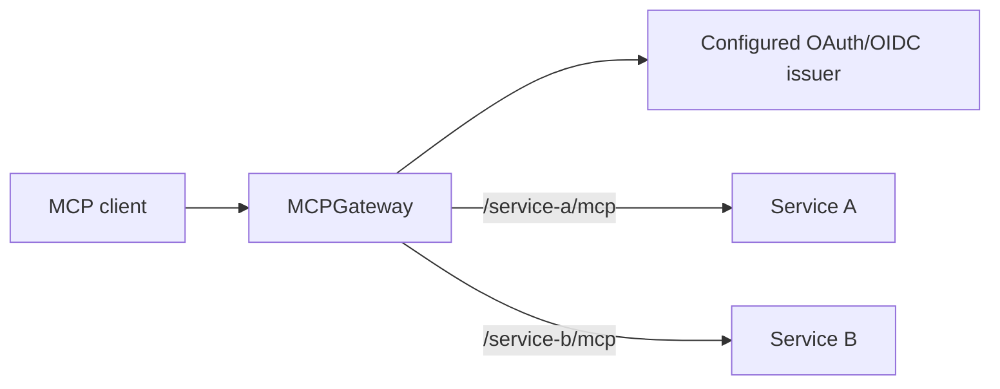

# MCPGateway

A standalone authenticated router for stateless Streamable HTTP MCP services.
Each backend has its own public route, audience and permission policy. The
router verifies an external access token, forwards only granted permissions,
and signs a short-lived identity for the selected backend. It contains no
application-specific service logic or dependency on another project.



## Try the local application

From this directory, with Go 1.26.9 or a compatible newer toolchain and Make:

```sh
make demo
```

This builds the binaries and runs a local agent-style client against the actual
gateway process and two copies of the included sample MCP backend. The client
uses the official MCP Go SDK to discover and call `echo`, `add` and `whoami` over
JSON and SSE, and verifies identity, permission and audience isolation plus
rejected requests. Everything binds to ephemeral `127.0.0.1` ports. The
self-contained mock OIDC issuer and ephemeral signing keys are development-only;
no accounts, provider credentials or external services are needed. Keys and
bearer tokens are never printed, and temporary files, listeners and the child
process are cleaned up on exit. See [the demo](docs/DEMO.md) for the scenario and
its limits.

The sample tools only return text, add two numbers and show the verified caller.
They do not execute commands, persist data or contact external services. The
sample server retains the SDK's localhost/origin protection and its executable
accepts only IP loopback listeners.

## Configure the gateway

```sh
make build
bin/gateway-keygen --private /private/gateway.private.json --public /private/public.jwks.json
bin/mcp-gateway --config /private/gateway.json
```

Adapt [examples/gateway.json](examples/gateway.json) for your own issuer and
backends. The production gateway always requires a configured discovered issuer
and a private signing JWK. It has no mock-authentication flag or identity bypass;
the demo issuer is confined to the separate demo executable.

Configuration is strict JSON: canonical public origin, issuer, private signing
JWK and 1–64 routes. Each route specifies an exact path ending `/mcp`, a fixed
upstream, a distinct backend audience, required scopes, forwarded scopes, allowed
OAuth client IDs and a positive integer `max_token_lifetime_seconds`. Missing,
zero, negative or non-integer lifetime limits fail startup. `upstream_host` can
preserve an upstream's configured canonical Host. Public URLs require HTTPS;
HTTP loopback is accepted for local development. Internal upstream HTTP requires
a trusted private network.

Clients use one route endpoint per service. Public protected-resource metadata
is at `/.well-known/oauth-protected-resource/<service>/mcp` and advertises that
route's exact resource and the configured issuer. `/health/live` indicates a
running handler; `/health/ready` indicates startup configuration, key loading
and issuer discovery. Neither asserts backend availability or ongoing issuer
connectivity. Health probes also require the configured canonical Host.

The gateway does not forward client cookies, identity headers, bearer tokens or
HTTP trailers. Backend response trailers are discarded. Backend informational
(1xx) statuses are preserved with their headers discarded; this stateless MCP
transport has no supported informational metadata.

HTTPS terminates at the operator's reverse proxy. Preserve canonical Host and
streaming, restrict the internal listener, and keep backend ingress private.
The [container skeleton](examples/compose.yaml) requires environment-specific
networking and HTTPS routing. Build with this directory as the entire context:
`docker build -t mcp-gateway .`. Its runtime image contains only the production
gateway, excluding the development issuer and example application.

## Authentication and permissions

The built-in authenticator supports signed RS256 JWT access tokens from one
configured discovered issuer. It accepts RFC 9068 `at+jwt` tokens with `client_id`,
or `JWT` tokens explicitly marked with payload `typ=Bearer` and `azp` (the
Keycloak profile). Opaque tokens, arbitrary JWT profiles and ID tokens are
unsupported. Verification requires the exact issuer, exactly one route-resource
audience, valid expiry/issued-at/not-before, subject and client identity.
Conflicting client claims fail.

Each route's `max_token_lifetime_seconds` bounds both the issued and remaining
external lifetime. Issuance must be positive and no later than the current time;
expiry must be in the future. The examples use 300 seconds. Choose an explicit
revocation bound for each backend and configure its provider accordingly. An old
long-lived token fails even when little time remains. Timing is checked again
after reading the body and before issuing backend identity. Internal tokens
expire within 60 seconds and never after the external expiry. Repeated requests
cannot extend the external grant. Clients refresh through their provider's
authorized flow.

A route resource is the exact public origin plus path. Provider clients,
callbacks, PKCE, consent, resource/audience bindings and permissions require
separate configuration. Discovery identifies the issuer; the gateway is not an
authorization server, client registration service or OAuth login proxy. A
provider's unsupported resource behavior needs an explicit integration rather
than relaxed audience verification.

Route access requires an allowed OAuth client and every required scope. Only
the intersection of granted scopes and `forward_scopes` reaches the backend:
configuration never invents a permission. Backends verify the signed identity
and enforce their own client, permission and ownership policies.
`gateway.Authenticator` is the extension boundary for future authentication
methods. Multiple simultaneous issuers and account linking are outside V1.

## Backend contract

External access tokens never reach a backend. Each backend verifies a separate
gateway-signed token for its own audience and retains original `(issuer,
subject)`, OAuth client identity and granted permissions. The backend owns its
internal account mapping and all application authorization. See [identity
contract v1](docs/IDENTITY.md).

The runnable reference server uses that same contract:

```sh
bin/example-mcp --listen 127.0.0.1:8090 \
  --gateway-issuer https://mcp.example.com --audience service-a-mcp \
  --jwks /private/public.jwks.json --client-id example-agent \
  --required-scope service-a:use
```

This matches the example service-a route. It still needs a running configured
gateway and a compatible access token; `make demo` supplies its own complete
local environment. Real-service integration is a separate, later approved step
after standalone MVP acceptance. Adding a service involves its identity
verification, own policy, one fixed route and provider resource configuration;
the gateway does not combine catalogs or rename tools.

## Protocol and failure boundaries

V1 targets the pinned MCP Go SDK v1.8.0 and stateless Streamable HTTP. It forwards
POST, GET and DELETE to exact fixed paths, preserving Accept, Content-Type and
MCP protocol-version headers. It also preserves `Mcp-Method`, `Mcp-Name` and the
protocol-defined `Mcp-Param-{Name}` namespace for schema-annotated arguments
(SEP-2243), supporting protocol `2026-07-28` without fallback. These are untrusted
protocol fields; the backend SDK validates them against message bodies and tool
schemas. Other `Mcp-*` headers are not implicitly forwarded.

JSON and request-bound SSE can stream. Session IDs, resumable standalone
streams, WebSockets, stdio, combined catalogs and server-initiated long-lived
sessions are unsupported. Backends issuing an MCP session ID are rejected.

Bodies are fully bounded to 6,422,528 bytes before dispatch. There are 64 active
requests per route and at most 64 routes, with a 35-second upstream budget.
Header, connection and TLS waits are bounded. POST calls are never retried
automatically, including after a lost acknowledgement. Cancellation propagates
to the backend request; it does not promise rollback of accepted work. Services
with writes must provide their own idempotency/status/lookup rules.

Routes, keys and policy load at startup; changes require restart. The gateway
is not an application's durable store. Logs contain route, duration and safe
operational messages, excluding payloads, tokens, cookies and user subjects.

## Validation

```sh
make check build integration demo
```

`check` runs formatting, vet and the module's race tests. `integration` runs the
local agent scenario with race detection against the built gateway executable,
mock issuer and sample backend handlers. All sources, tests, manifests and build
inputs belong to this module. Copy this directory alone to another location and
run the same commands; no parent checkout, sibling sources or repository scripts
are required. The dedicated CI workflow also runs these checks from an isolated
module copy. Dependency downloads still need normal Go package access.
The Make and container builds disable VCS stamping, so Git metadata is not a
build input.

Production rollout additionally needs reviewed provider registration,
TLS/network setup, key delivery and actual client login/refresh/use. See the
[rollout checklist](docs/ROLLOUT.md). Licensing for external redistribution must
be established before claiming an externally distributable release.
