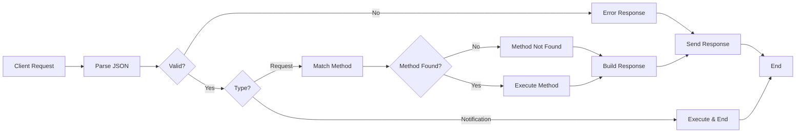

---
title: "Building a JSON-RPC Server in Go: Complete Implementation Guide"
date: 2025-08-30T10:00:00Z
lastmod: 2026-10-25
author: "Ou David"
draft: false
tags: ["golang", "json-rpc"]
categories: ["Technical Deep Dives"]
description: "Learn how to implement a complete JSON-RPC 2.0 server in Go with message parsing, validation, method routing, and error handling. Includes working calculator example."
toc: true
math: false
mermaid: true
---

A small JSON-RPC 2.0 server needs to parse messages, validate their shape, route method calls, and return either a result or an error with the matching ID. This Go calculator example follows that path and handles notifications without sending a response. It demonstrates JSON-RPC, not the full MCP lifecycle.


Last week, I posted about [JSON-RPC and the Model Context Protocol](/posts/json_rpc_the_protocol_behind_mcp/). Today, we're going to see an example of how we can create a simple application following the JSON-RPC standard. We'll build a simple JSON-RPC calculator together, and I hope you'll enjoy it.

## JSON-RPC server flow: parse, validate, dispatch, respond {#request-flow-overview}



## Message Parsing and Validation

Let's recap JSON-RPC message types. We have 3 types of messages: Request, Response, and Notification. For request and response types, we can send them in batches, and responses must be returned in a batch matching the request IDs in any order. We can distinguish between a request and a notification by checking the ID field. If there's an ID, it's a request; if not, it's a notification.

```Go
type JSONRPCNotification struct {
	JSONRPC string      `json:"jsonrpc"`
	Method  string      `json:"method"`
	Params  interface{} `json:"params,omitempty"`
}

type JSONRPCRequest struct {
	JSONRPC string      `json:"jsonrpc"`
	Method  string      `json:"method"`
	Params  interface{} `json:"params,omitempty"`
	ID      interface{} `json:"id"`
}

type JSONRPCResponse struct {
	JSONRPC string      `json:"jsonrpc"`
	Result  interface{} `json:"result,omitempty"`
	Error   *JSONRPCError `json:"error,omitempty"`
	ID      interface{} `json:"id"`
}

type JSONRPCError struct {
	Code    int         `json:"code"`
	Message string      `json:"message"`
	Data    interface{} `json:"data,omitempty"`
}
```

Now let's look at the parsing function:

```Go
// ParseSingleMessage parses a single JSON-RPC message
func ParseSingleMessage(data []byte) (interface{}, error) {
	// Parse once into a raw message that preserves ID field
	var raw struct {
		JSONRPC string          `json:"jsonrpc"`
		Method  string          `json:"method"`
		Params  json.RawMessage `json:"params,omitempty"`
		ID      *json.RawMessage `json:"id,omitempty"` // Pointer to detect presence
	}
	
	if err := json.Unmarshal(data, &raw); err != nil {
		return nil, &JSONRPCError{
			Code:    ParseError,
			Message: "Parse error",
			Data:    err.Error(),
		}
	}
	
	// Validate common fields
	if raw.JSONRPC != JSONRPCVersion {
		return nil, &JSONRPCError{
			Code:    InvalidRequest,
			Message: "Invalid Request",
			Data:    "jsonrpc field must be '2.0'",
		}
	}
	
	if raw.Method == "" {
		return nil, &JSONRPCError{
			Code:    InvalidRequest,
			Message: "Invalid Request",
			Data:    "method field is required",
		}
	}
	
	// Parse params once (same for both request and notification)
	var params interface{}
	if raw.Params != nil {
		if err := json.Unmarshal(raw.Params, &params); err != nil {
			return nil, &JSONRPCError{
				Code:    InvalidRequest,
				Message: "Invalid Request",
				Data:    "Invalid params field",
			}
		}
	}
	
	// Only difference: check ID at the end to determine type
	if raw.ID != nil {
		// It's a request (has ID, expects response)
		var id interface{}
		if err := json.Unmarshal(*raw.ID, &id); err != nil {
			return nil, &JSONRPCError{
				Code:    InvalidRequest,
				Message: "Invalid Request",
				Data:    "Invalid ID field",
			}
		}
		
		return JSONRPCRequest{
			JSONRPC: raw.JSONRPC,
			Method:  raw.Method,
			Params:  params,
			ID:      id,
		}, nil
	}
	
	// No ID = notification (no response expected)
	return JSONRPCNotification{
		JSONRPC: raw.JSONRPC,
		Method:  raw.Method,
		Params:  params,
	}, nil
}
```

This function converts the byte array into a raw struct, then validates required common fields like the JSON-RPC version and method. Finally, it identifies the message type (request or notification) by checking for the ID field.

## Message Type Routing

```Go
	switch msg := message.(type) {
	case []interface{}:
		// Batch request
		return s.handleBatchRequest(msg)
	case JSONRPCRequest:
		// Single request
		response := s.handleSingleRequest(msg)
		return json.Marshal(response)
	case JSONRPCNotification:
		// Single notification - no response
		s.handleNotification(msg)
		return nil, nil // No response for notifications
	default:
		// This shouldn't happen if parsing worked correctly
		errorResp := CreateErrorResponse(&JSONRPCError{
			Code:    InvalidRequest,
			Message: "Invalid Request",
			Data:    "Unknown message type",
		}, nil)
		return json.Marshal(errorResp)
	}

```

In this switch statement, we handle the request based on the message type. We distinguish between a single request, batch request, or notification. For notifications, the handling is simple: just execute the method call without any response.

```Go
func (s *JSONRPCServer) handleNotification(notif JSONRPCNotification) {
	log.Printf("Handling notification: %s", notif.Method)
	
	// Call method but ignore any result/error since it's a notification
	_, err := s.callMethod(notif.Method, notif.Params)
	if err != nil {
		log.Printf("Notification error (ignored): %v", err)
	}
}
```

On the other hand, for single or batch request types, we must return a response like this:

```Go
func (s *JSONRPCServer) handleSingleRequest(req JSONRPCRequest) JSONRPCResponse {
	// Route the method call
	result, err := s.callMethod(req.Method, req.Params)
	
	if err != nil {
		// Check if it's already a JSON-RPC error
		if jsonrpcErr, ok := err.(*JSONRPCError); ok {
			return CreateErrorResponse(jsonrpcErr, req.ID)
		}
		
		// Convert regular error to JSON-RPC error
		jsonrpcErr := &JSONRPCError{
			Code:    InternalError,
			Message: "Internal error",
			Data:    err.Error(),
		}
		return CreateErrorResponse(jsonrpcErr, req.ID)
	}
	
	return CreateSuccessResponse(result, req.ID)
}

func CreateSuccessResponse(result interface{}, id interface{}) JSONRPCResponse {
	return JSONRPCResponse{
		JSONRPC: JSONRPCVersion,
		Result:  result,
		ID:      id,
	}
}

```

## Method Execution

Up to this point, everything should be straightforward. In the request handler, we have this line that handles method calls:

```Go
result, err := s.callMethod(req.Method, req.Params)
```

Inside this `callMethod` function, we accept two parameters: a method name and the params. We handle the method call based on the method name from the request.

```Go
func (s *JSONRPCServer) callMethod(method string, params interface{}) (interface{}, error) {

	switch method {
	case "add":
		return s.callCalculatorMethod("Add", params)
	case "subtract":
		return s.callCalculatorMethod("Subtract", params)
	case "multiply":
		return s.callCalculatorMethod("Multiply", params)
	case "divide":
		return s.callCalculatorMethod("Divide", params)
	case "getInfo":
		return s.calculator.GetInfo()
	case "log":
		return s.callNotificationMethod("Log", params)
	default:
		return nil, &JSONRPCError{
			Code:    MethodNotFound,
			Message: "Method not found",
			Data:    fmt.Sprintf("Method '%s' is not available", method),
		}
	}
}

```

Finally, here's the inner function that handles method execution:

```Go
func (s *JSONRPCServer) callCalculatorMethod(methodName string, params interface{}) (interface{}, error) {
	// Parse parameters
	var calcParams CalculatorParams
	if params != nil {
		paramBytes, err := json.Marshal(params)
		if err != nil {
			return nil, &JSONRPCError{
				Code:    InvalidParams,
				Message: "Invalid params",
				Data:    "Cannot marshal parameters",
			}
		}
		
		if err := json.Unmarshal(paramBytes, &calcParams); err != nil {
			return nil, &JSONRPCError{
				Code:    InvalidParams,
				Message: "Invalid params",
				Data:    "Expected parameters: {\"a\": number, \"b\": number}",
			}
		}
	} else {
		return nil, &JSONRPCError{
			Code:    InvalidParams,
			Message: "Invalid params",
			Data:    "Parameters required: {\"a\": number, \"b\": number}",
		}
	}
	
	// Use reflection to call the method
	calcValue := reflect.ValueOf(s.calculator)
	method := calcValue.MethodByName(methodName)
	if !method.IsValid() {
		return nil, &JSONRPCError{
			Code:    InternalError,
			Message: "Internal error",
			Data:    fmt.Sprintf("Method %s not found on calculator", methodName),
		}
	}
	
	// Call the method
	results := method.Call([]reflect.Value{reflect.ValueOf(calcParams)})
	
	// Handle results (expecting result, error pattern)
	if len(results) != 2 {
		return nil, &JSONRPCError{
			Code:    InternalError,
			Message: "Internal error",
			Data:    "Unexpected return value count",
		}
	}
	
	// Check for error
	if !results[1].IsNil() {
		err := results[1].Interface().(error)
		return nil, err
	}
	
	// Return the result
	return results[0].Interface(), nil
}

```

In this function, we rely heavily on reflection to execute methods from the reflect package. After method execution completes, we return the response back to the request.

## Apply the JSON-RPC dispatch pattern {#wrapping-up}

Building a JSON-RPC server in Go is surprisingly straightforward once you understand the message flow. The key is proper parsing, validation, and method routing. Go's reflection makes dynamic method dispatch clean, and the JSON-RPC spec handles the rest.

This pattern works great for microservices, tool integrations, or any situation where you need structured RPC calls over various transports. Plus, understanding this foundation makes working with protocols like MCP much easier.

---

## Related protocol and HTTP articles {#more-deep-dives-you-might-like}

**[Understanding JSON-RPC: The Protocol Behind MCP](/posts/json_rpc_the_protocol_behind_mcp/)** - Get the conceptual foundation. This post explains why JSON-RPC was chosen for MCP and breaks down the protocol's design.

**[The HTTP Request Journey in Go](/posts/http_in_golang/)** - Compare protocol implementations. See how Go handles HTTP requests with the same internal patterns we used here for JSON-RPC.

---

Questions or thoughts about this? Hit me up at [oudavid@vvivid.dev](mailto:oudavid@vvivid.dev).
